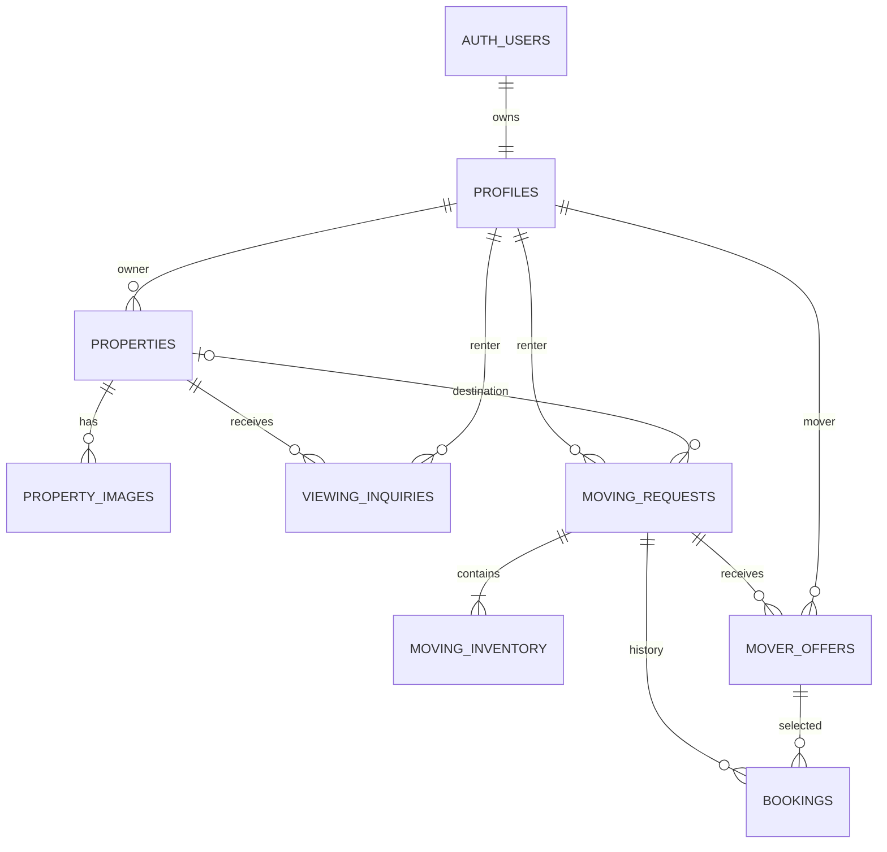

# BashaShift — Architecture and implementation choices

## The value proposition

Unlike a standalone property classified or mover directory, BashaShift carries a renter's selected home and destination into a **single moving-request workflow**. Workers get locally relevant, itemized requests; customers compare quotes and complete the final agreement by phone, fitting existing communication habits.

Don't claim to invent any of the individual components. The innovation claim is **coordination, low-friction worker participation, inventory-assisted quoting, and transparent customer control**.

## Stack: minimal, credible, upgradeable

- **Client:** React + Vite + ordinary CSS; React Router optional later. Current starter uses page state so it is simple to understand.
- **Server API:** Node 22+ + Express. Existing optional AI secret remains server-only; Phase 2 uses the Supabase browser SDK and database authorization.
- **AI:** Vision-enabled OpenAI Responses API (`POST /api/scan`): extracts visible furniture categories with bounded quantities and explicit uncertainty. User edits. The AI does not set prices or assign workers.
- **Database:** Supabase Postgres. Phase 2 tables: `profiles`, `properties`, `property_images`, `viewing_inquiries`, `moving_requests`, `moving_inventory`, `mover_offers`, and `bookings`. Migration and setup: `docs/SUPABASE_SETUP.md`.
- **Authentication:** Supabase email/password Auth. Each account selects one immutable application role: owner, renter, or mover. These are not PostgreSQL privilege roles. Roles are read from database profiles, never trusted from editable Auth metadata. Email confirmation is supported; identity and phone verification/OTP are not implemented.
- **Photo storage:** Private Supabase `property-images` bucket. Owners upload under their user/property IDs. Published listing photos can be read through short-lived signed URLs; drafts are restricted to their owner. Phase 2 does not store AI inventory photos.
- **Refresh:** Published property changes use Realtime. Private request/contact tables are excluded from the publication; authorized records refresh on focus, every 15 seconds, or manually. No SMS integration.
- **Hosting:** Node-enabled host for Express + React build; `.env` set through server environment. Use separate frontend/API if static hosting is desired.

## Phase 2 data model



Foreign keys bind a booking to its exact request/renter and offer/mover. Partial
unique indexes allow one pending offer per mover/request and one active booking
per request. Checks bound quantities, prices, roles, phone format, and states.
A profile is created by a validated Auth signup trigger. The browser cannot
insert a replacement profile, change roles, transfer property ownership, or
forge booking states.

RLS is enabled on all eight tables. `moving_requests` grants API roles SELECT on
only safe columns; contact/name/precise-address/notes columns are never granted.
`get_request_contact` authorizes the renter or a selected mover with consent.
`get_property_contact` authorizes the owner or a renter with a viewing inquiry.
`mover_summaries` exposes only the required mover summaries and limits phone
access to selection participants. Profiles themselves are readable only by self.

Cross-row transitions use narrowly scoped SECURITY DEFINER functions with empty
search paths, explicit actor checks, and request-row locks. PUBLIC/anon function
execution is revoked. Direct writes cannot bypass the transition rules. Offer
insertion also locks/rechecks the request to prevent racing a closed selection.

## Booking lifecycle

```text
DRAFT → OPEN (visible only to eligible area/category workers)
  OPEN → OFFERED (0..N accepted/counterpriced worker offers)
  OFFERED → AWAITING_CALL (renter selects exactly one offer)
  AWAITING_CALL → CONFIRMED (renter confirms *after* phone call)
  AWAITING_CALL → OPEN (renter declines and reopens)
  OPEN → CANCELLED
  CONFIRMED → COMPLETED / CANCELLED [post-MVP]
```

**Concurrency:** `select_mover_offer`, `reopen_moving_request`, and `confirm_booking` lock the request and update state transactionally. The active-booking unique index independently rejects competing active selections. Confirmation records a renter's self-reported phone agreement; it does not verify that a phone call occurred.

**Worker privacy:** Workers see general origin area, moving date, basic item inventory and indicative price before selection. Do not expose customer name, exact address, or phone. After the renter selects the worker and consents, the worker can access the contact. The selected worker's phone is made available to the renter, with a visible warning if the account isn't verified.

**Owner privacy:** Full property address is optional and should not be public by default; neighborhood/block is sufficient until an inquiry or owner-approved conversation.

## AI endpoint behavior

`POST /api/scan` takes `{ "images": ["data:image/jpeg;base64,..."], "consent": true }`.
In production it requires a Bearer session verified against Supabase Auth and
the protected renter profile. The backend alone holds the OpenAI key. It
validates and re-encodes up to three photos (3 MiB each, 6 MiB total,
20-megapixel decoded limit), strips metadata, and calls the Responses API with
`store:false` and a strict catalog schema. Timeouts, rate limits, and bounded
concurrency protect the route. Response:

```json
{
  "source": "openai",
  "model": "gpt-4.1-mini",
  "reviewRequired": true,
  "items": [ { "name": "Bed", "qty": 1, "confidence": "high" } ]
}
```

These are **suggestions**, not verified detection counts. The user reviews every
item; applying the review replaces the current inventory rather than adding to
example counts. Missing items can be added manually. Empty recognized lists,
invalid input, unavailable keys, or provider errors leave manual inventory
unchanged. Photos remain ephemeral and are not stored with the request.

The deterministic estimator uses the existing handling rates plus BDT 850
vehicle base, BDT 45/km, and BDT 100 per combined floor if lift access at both
buildings is absent, rounded up to BDT 50. The UI shows every term. AI does not
set prices. The approved list and formula total use the existing
`create_moving_request` RPC; RLS and private contact access are unchanged.
See `AI_SETUP.md` for the formula, deployment setup, privacy, and limits, and
`PHASE3_QA.md` for mocked vs real integration evidence.

**Testing mandatory:** test with owned/permissioned furniture photographs, including multiple beds, boxes, irrelevant photos, poor lighting, and a photo with no furniture. Log expected vs recognized categories without claiming medical-grade/object-detection reliability. Check API cost and any provider image-retention policies.

## Important real-world risks

1. Need verified owner inventory (otherwise empty marketplace).
2. Worker fraud/safety risk: profiles cannot be presumed checked.
3. Approximate pricing requires reliable exclusions (truck size, fragile items, disassembly, lift, distance, traffic and timing).
4. Worker response must be phone-first but **not** legally or technically assumed confirmed.
5. Two-sided supply and demand creates cold-start challenges. For the hackathon, label sample records and show a prototype, not fake user traction.
